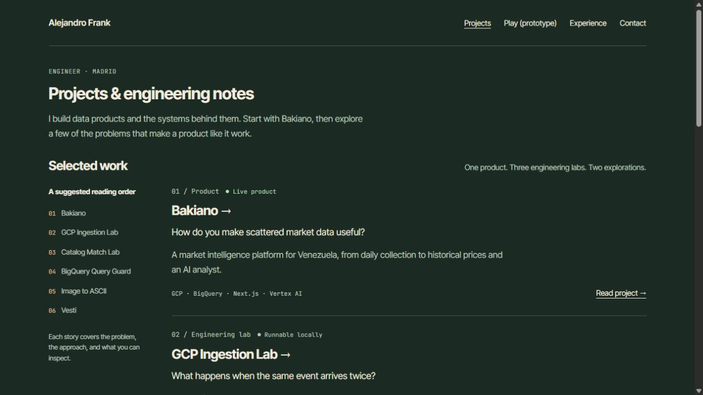
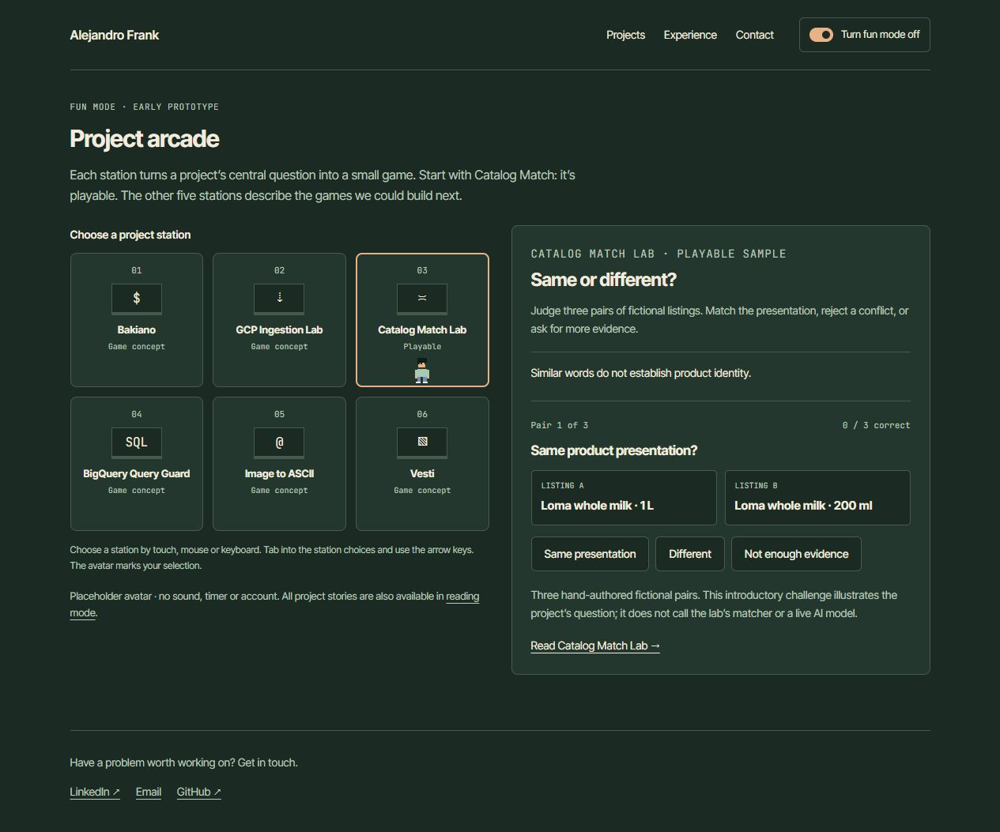

# Alejandro Frank — engineering portfolio

An engineering portfolio with a suggested reading path: Bakiano, the ingestion, catalog-matching and query boundaries behind data products, visual experiments, and work in progress.

**[Explore the live site](https://me.alejandrofranks.workers.dev)** · **[Career timeline](https://me.alejandrofranks.workers.dev/timeline)** · **[Bakiano case study](https://github.com/alejandrofrank/bakiano-showcase)**

## What you can explore

- **Project index:** six visible project summaries with status, a concrete engineering question, and a suggested reading order.
- **Project pages:** `/projects/:slug` explains the problem, approach, inspectable evidence and limitations. Three runnable labs include local setup instructions. Bakiano and Vesti retain their technical walkthroughs.
- **Experience:** a career timeline with role-by-role system diagrams and written explanations.
- **Live activity:** a GitHub contribution calendar fetched at the edge, with a profile link available if the API is unavailable.
- **Reading interface:** compact titles, direct project links, keyboard navigation, responsive layouts and print styles. Reading the projects requires no JavaScript.
- **Optional fun mode:** the portfolio opens in work mode. “Turn fun mode on” enters `/play`, with a placeholder pixel avatar, six project stations, and one playable three-pair identity challenge. “Turn fun mode off” returns to the project index. Five other games are labeled concepts. [Direction and next steps](docs/project-arcade.md).

### Interface previews





## How it works

Hono renders HTML on Cloudflare Workers. Content, page layouts, visual effects, and data panels are separate modules. Public GitHub data uses the REST API; an optional token enables the contribution calendar through GraphQL. Responses are cached to limit repeated upstream requests.

The experience walkthroughs use a Python scene builder that produces JSON for an SVG player. The same roles are available as readable text and a print layout.

## Run locally

```bash
git clone https://github.com/alejandrofrank/alejandrofrank-eng.git
cd alejandrofrank-eng
npm ci
npm run dev
```

The basic site runs without a GitHub token. To enable the contribution calendar locally, add your token as `GITHUB_TOKEN` in a gitignored `.dev.vars` file. `GITHUB_USER` is configured in `wrangler.jsonc`.

```bash
npm run typecheck
npm test
npm run deploy
```

Deployment requires your own Cloudflare account and Worker configuration. Set the `GITHUB_TOKEN` Worker secret separately if you want the calendar in production.

## Project map

| Path | Purpose |
| --- | --- |
| `src/content.ts` | Shared product links and career context |
| `src/projects/catalog.ts` | Project descriptions, evidence, status and reading order |
| `src/projects/page.ts`, `src/projects/styles.ts` | Project index and individual reading pages |
| `src/play/page.ts`, `public/play/` | Optional arcade prototype and local game state |
| `src/index.ts` | Routes: homepage, `/projects/:slug`, `/timeline`, `/resume`, and `/health` |
| `src/layout.ts` | Homepage composition |
| `src/panels/` | Project panels, technical explanations, and GitHub data |
| `src/timeline/` | Interactive career timeline |
| `src/resume/` | Role walkthroughs, SVG player, and readable text |
| `resume/` | Python scene builder and role definitions |
| `src/styles.ts`, `src/personal-styles.ts` | Shared and homepage styling |
| `public/` | Static assets |

## Status

Projects described inside the portfolio have their own status. Bakiano is live, the three engineering labs run locally, Image to ASCII is experimental, and Vesti is in development. Branch changes can be reviewed locally before deployment.
